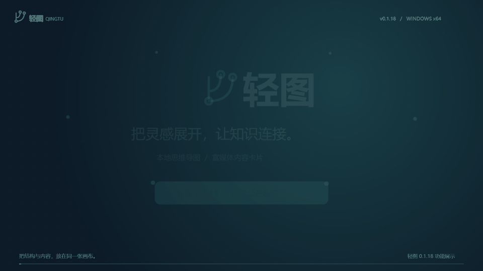
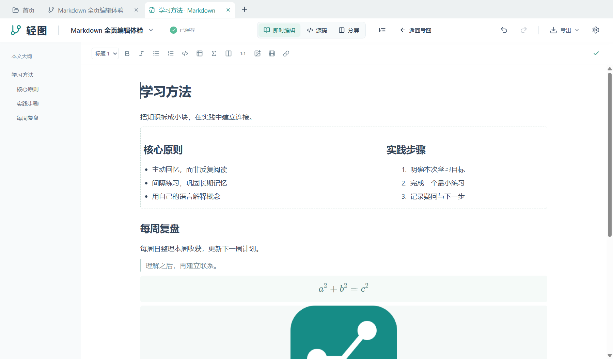
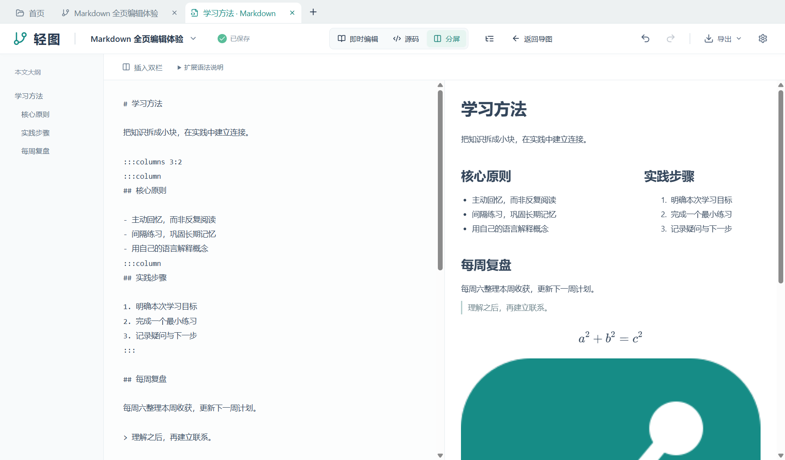
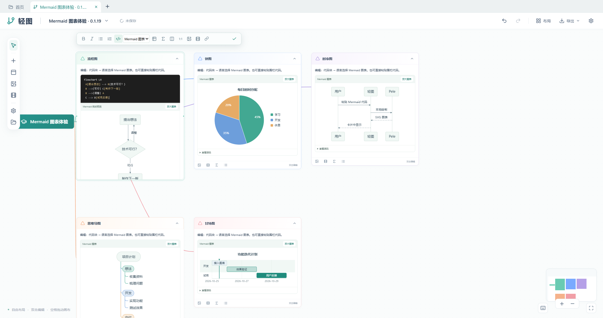
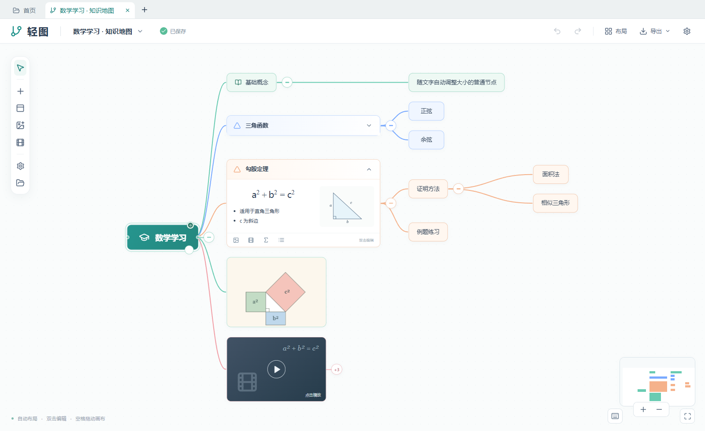
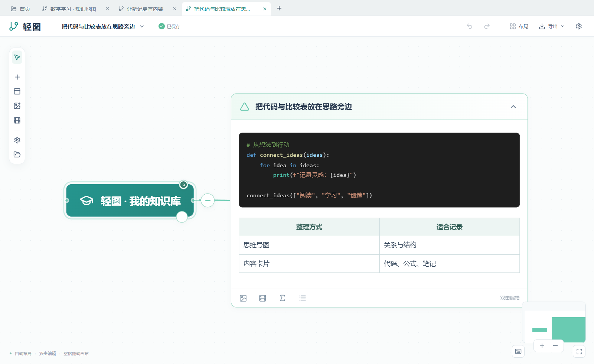
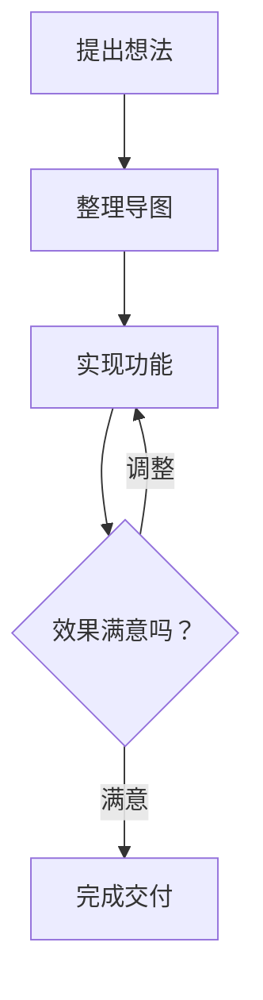
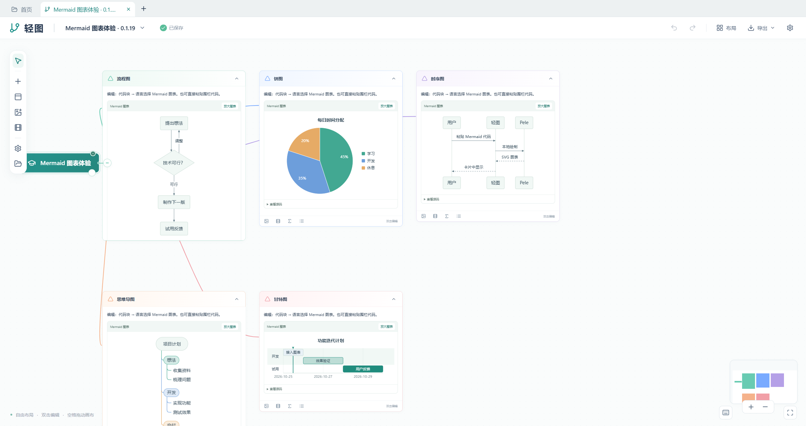

<div align="center">

# 轻图 Qingtu

**把灵感展开，让知识连接。**

本地桌面思维导图 · 富媒体内容卡片 · Windows x64

[下载 v0.1.24](https://github.com/Pxyfcywl/qingtu/releases/tag/v0.1.24) · [观看宣传片](https://github.com/pxyfcywl/qingtu/releases/download/v0.1.18/qingtu-0.1.18-promo.mp4) · [反馈问题](https://github.com/pxyfcywl/qingtu/issues)

[](https://github.com/pxyfcywl/qingtu/releases/download/v0.1.18/qingtu-0.1.18-promo.mp4)

上方为 0.1.18 的功能预览，点击观看 43 秒的完整宣传片（含配乐）；新版 Markdown 全页编辑与 Mermaid 图表见下方。

</div>

轻图把思维导图和内容笔记放在同一张画布上。用节点梳理结构，用卡片写下推导、代码和详细笔记，把图片、公式与本地视频连接到你的思路里。

**当前版本：v0.1.24 · 单卡片 Markdown 演示（2026-10-28）。** 本地资料保存在你选择的文件夹中，日常使用无需登录账号。

## v0.1.24：把当前 Markdown 卡片作为幻灯片播放

在 Markdown 全页编辑的顶部点击“演示”，按标题层级与实际内容高度生成 16:9 页面。只播放当前卡片，不使用 AI、不改写原文；退出后继续编辑。

- 长正文延续原章节标题，显示章节路径与“续页”，支持目录跳转、方向键翻页和全屏。
- 保留双栏、Mermaid、公式、本地图片与视频。段落、列表、普通代码和简单表格可拆页，表格续页重复表头。
- 超长完整内容可滚动或展开阅读；独立的 `---` 分隔线可用于手动分页。
- 目录可收起，底部翻页控件自动淡出。首版暂不提供逐页人工合并与 PPTX 导出。

[演示使用指南](docs/markdown-presentation.md)

## v0.1.23：在独立标签页编辑 Markdown 卡片

点击 MD 内容卡片右上角的“全页编辑卡片”，或选中卡片后点击顶部“Markdown 编辑”，即可在独立标签页中编辑当前卡片。修改自动同步回原卡片，保存和撤销沿用导图的操作记录。

- 提供即时编辑、Markdown 源码和源码 / 排版分屏，可收起的本文大纲支持定位标题。
- 保留双栏、比例、公式、代码、Mermaid、本地图片与视频；源码通过扩展语法与内容保留块表达专有结构。
- 编辑视图、大纲开关和“返回导图”合并到主导航栏，正文区不再显示重复标题行、底部操作提示或状态栏。
- 未完成的扩展源码保留在当前页，补全后继续同步；卡片名称在顶部标签显示，保存状态在主导航栏显示。



[Markdown 全页编辑使用指南](docs/markdown-workspace.md) · [下载可导入的体验导图](https://github.com/Pxyfcywl/qingtu/releases/download/v0.1.23/qingtu-0.1.23-markdown-example.qmap)



## Mermaid 图表：让代码变成图表

在内容卡片里写标准 Mermaid 代码，由本地打包的 **Pele 1.6.0** 绘制成 SVG。无需学习另一套图表语法，普通图表渲染不依赖联网服务。

- 沿用原有代码块，语言选择 **Mermaid 图表**；也可直接粘贴完整的 Mermaid 围栏。
- 编辑时同时显示源码与实时预览，完成编辑后直接阅读图表。
- 支持查看源码、全窗口放大、普通滚轮缩放、左键拖动平移和 Esc 返回。
- 保存、重新打开及项目导出保留图表源码；导图 PNG 导出保留配色并隐藏操作按钮。



[下载可导入的五种图表示例](https://github.com/Pxyfcywl/qingtu/releases/download/v0.1.20/qingtu-0.1.20-mermaid-examples.qmap) · [查看 Markdown 示例](docs/examples/mermaid.md)

## 你可以用轻图做什么

| 功能 | 用法 |
| --- | --- |
| 思维导图 | Tab 添加子节点，Enter 添加同级节点，自动整理布局或自由拖动 |
| 内容卡片 | 富文本、Markdown 粘贴、列表、公式、代码高亮和表格 |
| Markdown 全页编辑 | 当前卡片独立标签页，即时编辑、源码、分屏和大纲，正文自动同步回卡片 |
| Markdown 演示 | 当前卡片按标题和内容高度分页播放，支持续页、目录、键盘翻页和全屏 |
| Mermaid 图表 | 在代码块中绘制流程图、时序图、饼图、思维导图、甘特图等，源码可继续编辑 |
| 图片与视频 | 插入图片和本地 MP4；原图预览支持按鼠标位置缩放、拖动查看 |
| 多级列表 | 正文 Tab / Shift+Tab 调整层级，显示 `1.`、`1.1`、`1.1.1` |
| 灵活组织 | 正文与后代分别折叠；更换父节点，或让一个节点连接多个父节点 |
| 资料管理 | 首页文件夹、名称搜索、多导图标签与重启后恢复 |
| 保存与分享 | 自动保存、撤销重做、`.qmap` 项目导入导出、PNG 图片导出 |



## 下载与安装

前往 [v0.1.24 发布页](https://github.com/Pxyfcywl/qingtu/releases/tag/v0.1.24)，下载 `qingtu-0.1.24-windows-x64-setup.exe`，按向导完成安装。首次启动时选择资料库存储位置。普通使用无需安装 Node.js、Rust 或 Python。

需要 Windows x64 和 WebView2。安装器在缺少 WebView2 时需要联网下载运行时。应用尚未进行商业代码签名。

已有旧版的用户可下载 `qingtu-0.1.24-update.zip`，解压后运行 `覆盖更新.cmd`，选择原程序目录。更新前保存编辑并备份重要资料；程序目录与资料库分开存放。[详细安装与更新说明](docs/release/0.1.24-install.md)。

## 从第一张导图开始

1. 在首页点击“创建新的思维导图”。
2. 选中节点，按 Tab 新增子节点，按 Enter 新增同级节点。
3. 双击标题或卡片正文编辑，按 Esc 完成正文编辑。
4. 在内容卡片中插入公式、代码、表格、图片或视频；正文里的 Tab 用于列表缩进。
5. 用顶部“布局”整理画布，通过“导出”保存 `.qmap` 项目或 PNG 图片。

需要更大的正文空间时，使用卡片右上角“全页编辑卡片”。全页编辑中 `Ctrl+/` 切换即时编辑与源码，Esc 返回导图；“分屏”用于同时查看源码与排版。

正文中按 **Alt+A** 可根据鼠标位置选择内容：鼠标停在代码块内时选择该代码块，停在其余正文时选择整篇正文；阅读与编辑均可使用。



## 在卡片中插入 Mermaid 图表

双击正文，点击“代码块”，把光标放进代码块后，在工具栏“代码语言”里选择 **Mermaid 图表**。输入下面的源码即可预览：



也可直接粘贴包含三个英文反引号的完整 Markdown 围栏。支持的图表范围见 [Pele 官方示例](https://pele.run/examples)。Pele 使用自己的布局与配色方式，与 Mermaid.js 的外观和高级配置不完全相同；当前应用不启用图中外部链接与外部图片。



## 从源码运行

技术栈：Tauri 2、Rust、SQLite、React、TypeScript、React Flow、Tiptap、KaTeX、Pele、Vite。

准备 Node.js 22 LTS（或满足 Vite 7 要求的版本）、npm、Rust stable、Visual Studio C++ Build Tools、Windows SDK 和 WebView2。依赖版本由 `package-lock.json` 与 `src-tauri/Cargo.lock` 固定。

```powershell
npm ci
npm run tauri -- dev
```

前端开发预览：`npm run dev`。浏览器预览使用独立的开发数据，桌面保存、项目文件和 PNG 导出需在桌面版使用。

```powershell
npm test
npm run test:ui
cargo test --manifest-path src-tauri/Cargo.toml --lib
npm run tauri -- build
```

`scripts/toolchain.ps1` 和 `tauri.tools.conf.json` 用于原开发机的便携工具链；其他电脑使用自己安装的标准工具链即可。

## 发布与验证

v0.1.24 通过 **71 项单元测试、40 项相关界面回归和 20 项独立桌面检查**，覆盖当前卡片范围、分页与标题连续性、跨页代码与表格保留、双栏、图表、公式、媒体、全屏和退出后原文不变。相关界面回归范围见本版验证记录，未宣称全部历史界面用例通过。

上一公开版 0.1.23 的完整浏览器回归仍有顶部拖线用例断言超时；本版未重新执行完整历史回归，详见[既有回归记录](docs/release/0.1.23-regressions.json)。

桌面验证使用独立应用标识与隔离资料库的调试构建；其 **84 个前端文件与正式构建逐一核对 SHA256，全部一致**。GitHub 安装程序沿用本次已验证的本地生产构建。

[本版验证记录](docs/release/0.1.24-verification.json) · [本版生产源码指纹](docs/release/0.1.24-source-fingerprint.json) · [更新记录](CHANGELOG.md)

完整性能、长期内存和干净系统安装验收仍沿用既有未完成状态。宣传片来自 0.1.18 的演示资料，新版截图来自隔离桌面验证。

## 第三方组件

第三方依赖的许可与声明见 [third-party-notices.txt](public/third-party-notices.txt)。本仓库暂未指定项目自身的开源许可证。
